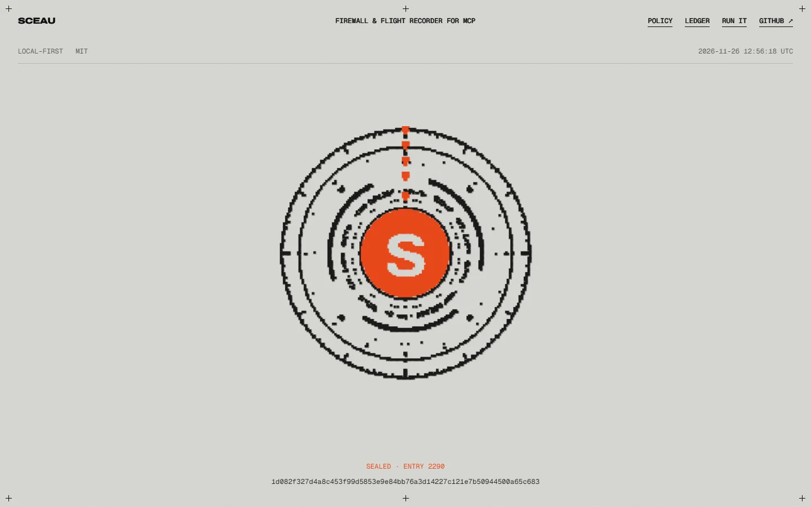
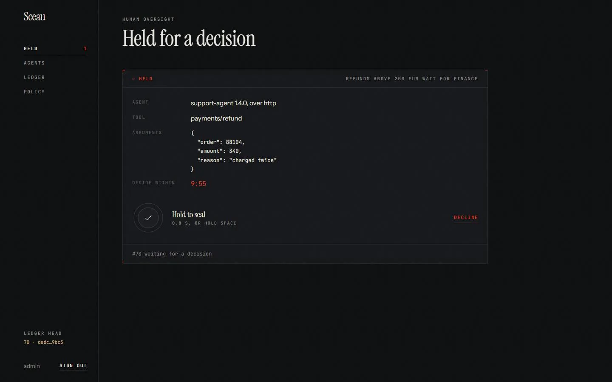

# Sceau

A firewall and flight recorder for AI agents' tool calls. Sceau sits between agents and the MCP servers they use: it applies a policy to every call, holds the ones a person should decide, masks personal data before the model reads it, refuses tool results that try to steer the agent, and writes everything to a hash-chained, signed ledger that an auditor can check without trusting you.



## Why

Most teams that give an agent access to a database, a payment API or a mail relay find out what governance means the day they try to sell to a bank or an insurer. The client's security team asks three things: what exactly can the agent do, who approved the risky actions, and can you prove the logs were not edited afterwards. Application logs answer none of them well, and adding checks inside every agent means doing it again for each framework and each language.

MCP gives all of this one place to stand. Every tool call is a JSON-RPC message on a known transport, so a proxy on that wire sees everything the agent does to the outside world, whatever the agent is written in. Sceau is that proxy, kept deliberately small: one Node process, one YAML file, one folder of state.

## What it does

**Policy.** Rules in YAML, first match wins. A rule matches a server and tool (`payments/refund`, `*/send_email`) and can look at the arguments: numbers (`amount > 200`), lists, regular expressions, the domains in an address, the kinds of SQL statement a query would run, or the kinds of personal data the agent is passing back. The verdict is `allow`, `deny` or `hold`. When no rule matches, a tool that declares itself read-only runs and anything else waits for a person. A rule the loader cannot read stops Sceau from starting.

**Holds.** A held call stays open on the agent's side while a person decides, in the console (sealing is a press held for 0.8 s, not a click) or from Slack buttons. Over HTTP the answer becomes an event stream at once, with progress notifications so SDK clients do not hit their one-minute timeout. If nobody answers before `approvals.timeout`, the agent is told no.

**Masking.** IBANs (country length and mod 97), card numbers (Luhn), provider API keys, emails and phone numbers in tool results become stable tokens like `[IBAN_7b8c8bfb]`. When the agent passes a token to a tool, Sceau restores the value, and the policy knows the call carries it: `if: [{ carries: [iban] }]` on `send_email` stops bank details leaving by mail. The token table is in memory only.

**Injection.** Tool results and tool descriptions are scanned for hidden Unicode tag text, planted instructions (HTML comments included), chat role markers and links built to exfiltrate. A result that carries one is withheld from the model; a tool whose description carries one is dropped from the list. A tool whose description changes after it was first seen is recorded as changed.

**Ledger.** Every session, tool list, call, decision, approval and result is one JSON line with the SHA-256 of its content and of the previous line, and an Ed25519 signature, fsynced before the call proceeds. Arguments are stored masked. The console exports any range as an evidence pack: the ledger slice, the public key, the policy, a readable report and a manifest signed over all of it, checkable with OpenSSL alone (see `VERIFY.txt` inside a pack).



## Try it

Node 24 and pnpm:

```sh
pnpm install
pnpm demo
```

That starts three demo tool servers (a CRM on SQLite, payments, mail), a stdio file server with a poisoned invoice on its drive, Sceau in front of them, and a scripted support agent that works one ticket every 30 seconds. Open http://localhost:7325, sign in as `admin` / `seal-it-yourself`, and seal or decline its 340 EUR refund.

With Docker, the same stack:

```sh
docker compose up --build
SCEAU_RELAY_TOKEN=demo-relay-token pnpm e2e
```

`pnpm e2e` plays the ticket, seals the refund as an approver would, then checks the ledger and an evidence pack. It is what CI runs.

## Putting it in front of your tools

```sh
docker run -p 7325:7325 \
  -v ./sceau.yaml:/etc/sceau/sceau.yaml -v sceau:/var/lib/sceau \
  -e SCEAU_ADMIN_PASSWORD=... ghcr.io/toni-bobocel/sceau
```

Start from [deploy/sceau.yaml](deploy/sceau.yaml); [deploy/demo.yaml](deploy/demo.yaml) is a complete policy. HTTP servers are listed with their URL and reached at `/mcp/<name>`. A stdio server is started by the agent's MCP client as usual, with `sceau wrap` in front:

```json
"files": {
  "command": "sceau",
  "args": ["wrap", "--server", "files", "--daemon", "http://sceau.internal:7325",
           "--", "npx", "@modelcontextprotocol/server-filesystem", "/srv/share"]
}
```

`wrap` fails closed: if it cannot reach the proxy it refuses tool calls and withholds results rather than passing them through. Wrappers on another host need `SCEAU_RELAY_TOKEN`.

Other commands: `sceau user add <name>` creates an approver, `sceau verify <ledger.jsonl | pack.zip>` checks a chain or a pack, `sceau pack` writes a pack without the server running.

## How it is put together

```
agent ──HTTP──► /mcp/<server> ─┐                      ┌─► MCP server (HTTP)
agent ──stdio─► sceau wrap ────┼─► Gate ──────────────┤
                               │   policy, holds,     └─► MCP server (stdio, via wrap)
console, Slack ◄── events ─────┘   vault, scanner
                                        │
                                   ledger.jsonl  ── sceau.key (Ed25519)
```

`proxy/src/gate.ts` is the whole pipeline and knows nothing about transports. `server.ts` adapts Streamable HTTP and the wrapper relay to it, `cli.ts` is the process. Decisions about the shape are in [docs/adr](docs/adr).

## Limits

- Sceau sees what crosses MCP. The conversation between an application and its model does not, except a server's `sampling/createMessage`, which is recorded.
- Agent identity is what the client declares in `initialize`, plus its address. Strong identity (mTLS, OAuth client credentials) would come first in a real deployment.
- Injection detection is heuristic. It catches the common, known shapes; the policy is what actually limits the damage.
- The ledger is tamper-evident against anyone without the key. Cutting entries off the end leaves a valid shorter chain; an exported pack pins its head, and anchoring heads elsewhere (below) closes the rest.
- Tokens die with the process, by design. An agent that holds a token across a restart gets the token text back, not the value.
- OAuth discovery for upstream servers is not proxied; give Sceau a service token per server in `headers`.

## At scale

I would anchor the ledger head every few minutes outside the machine (an RFC 3161 timestamp authority, or a transparency log), keep the signing key in a KMS or HSM, move holds and sessions to Postgres so several replicas can share them, sign approvers in with the company's OIDC provider, and replace the SQL tokenizer with a real parser per dialect (libpg_query for Postgres). Multi-tenant policies and per-team approval routing would follow from the first customer that asked.

## Development

```sh
pnpm test        # vitest: policy, SQL, masking, injection, ledger, packs, and the official MCP SDK through the proxy
pnpm lint
pnpm typecheck
pnpm dev         # the site and console with Vite, on :5183 (run pnpm demo alongside for the API)
```

`proxy/` is the product, `web/` the console and site, `demo/` the tool servers and the agent.

## Licence

MIT
